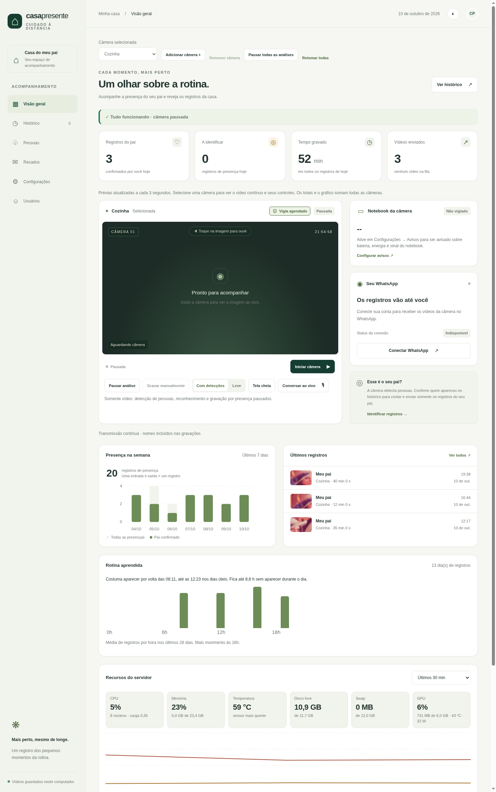
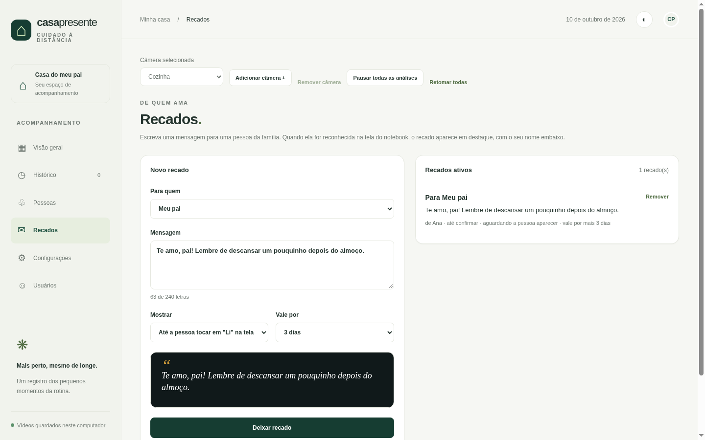

# Casa Presente

**Monitoramento de presença para cuidar de quem você ama, rodando 100% na sua casa.**

Uma câmera na cozinha, um computador em casa e nenhuma nuvem: o sistema percebe quando alguém aparece, grava só
esses momentos, reconhece quem é (por exemplos que você confirma), avisa a família pelo WhatsApp e pelo celular e
ainda oferece uma tela no notebook da cozinha para chamar a família, ver fotos, recados e o calendário.

`Python 3.11+` · `FastAPI` · `YOLO26 (PyTorch, ONNX, OpenVINO)` · `YuNet + SFace` · `SQLite` · `FFmpeg` · `Node 22 + Baileys`

| Painel (visão geral) | Totem: moldura de fotos |
|---|---|
|  |  |

> Imagens ilustrativas, geradas com dados de demonstração (`scripts/demo_seed.py`). Nenhum dado real aparece aqui.

## Destaques

| Área | O que faz |
|---|---|
| **Presença** | Detecta pessoas com YOLO26, acompanha cada corpo (ByteTrack) e abre um registro por período contínuo de presença. Grava só enquanto há alguém, com áudio do ambiente. |
| **Reconhecimento** | Rostos (YuNet + SFace) comparados com os exemplos que você cadastra ou confirma, várias pessoas ao mesmo tempo, com memória corporal opcional (ReID). Tudo local; nada é treinado na nuvem. |
| **Avisos** | Vídeos e alertas pelo WhatsApp (Baileys) para até 10 números, notificações push no celular (PWA), alerta de queda, inatividade, rotina fora do padrão e bateria do notebook. |
| **Totem** | Tela do notebook da cozinha: chamar a família, moldura de fotos, calendário com feriados, saudação por nome, aniversários, lembretes e **recados** privados com confirmação "Li", e à noite a tela escurece ou apaga e liga quando alguém chega. [Guia do totem](docs/totem.md). |
| **Desempenho** | Detector configurável por câmera: modelos n/s/m/l × PyTorch, ONNX, OpenVINO e OpenVINO INT8, baixados só quando escolhidos. Modo vigia noturno que poupa CPU. Roda até num notebook de 2013. |
| **Câmeras** | RTSP, webcam/câmera USB local (V4L2), várias câmeras, áudio ao vivo ("Conversar ao vivo") e vídeo leve para o celular. |
| **Operação** | Usuários com perfis (administrador e família), backup automático, monitor de recursos (CPU, memória, temperatura, GPU), acesso de fora de casa por Tailscale, Docker. |

## Capturas de tela

| Recados | Configurações do totem |
|---|---|
|  |  |

| Totem com botões | Totem à noite | Recado na tela |
|---|---|---|
|  |  |  |

## Como funciona

```
 Câmera USB ──┐                          ┌─────────────────────────────────────────────┐
 ou RTSP ─────┼──▶  Captura (OpenCV)  ──▶│ Movimento? ─ sim ─▶ YOLO26 ─▶ tracking      │
 (MediaMTX)   │                          │                       │                      │
              │                          │          rosto (YuNet) ─▶ SFace ─▶ quem é?   │
 Microfone ───┘                          └───────────────┬─────────────────────────────┘
                                                          ▼
   Gravação (MP4 + áudio) ◀── presença ──▶ SQLite ──▶ Painel web (FastAPI) ──▶ WhatsApp · push · Totem
```

- **Um processo Python** (API, câmeras, reconhecimento, filas) e **um serviço Node** (WhatsApp/Baileys). Execute
  uma única instância.
- O **monitor do notebook** (`notebook/monitor.py`) serve a tela do totem e lê bateria e energia; o painel fala
  com ele por um token compartilhado.
- Os dados ficam em `./data`: banco, rostos, vídeos, fotos, configurações e a sessão do WhatsApp.

## Começando

**Requisitos:** Linux de 64 bits, Python 3.11+, Node 22+, FFmpeg com `libx264`. Uma GPU NVIDIA ajuda, mas não é
necessária: em CPU, use o modelo n com ONNX ou OpenVINO.

```bash
python3 -m venv .venv
.venv/bin/python -m pip install -r requirements.txt
.venv/bin/python scripts/download_models.py     # YOLO26n, YuNet, SFace e ReID, com SHA-256
npm ci
cp .env.example .env                            # defina DASHBOARD_PASSWORD para o primeiro acesso
./start.sh
```

Abra **http://localhost:8000**. Depois:

1. Em **Configurações → Câmera**, informe o endereço RTSP ou escolha uma câmera USB da lista, e clique em
   **Iniciar câmera** na visão geral.
2. Em **Pessoas**, cadastre quem aparece em casa (foto nítida do rosto) e, no **Histórico**, confirme os rostos
   para a aplicação aprender.
3. Em **Configurações → WhatsApp**, escaneie o QR code e informe o número que receberá os vídeos.
4. Instale o [totem](docs/totem.md) no notebook da cozinha, se quiser.

**Docker:** `docker compose up -d --build` (GPU NVIDIA: `docker compose -f docker-compose.yml -f docker-compose.gpu.yml up -d --build`).
Tudo o que importa fica em `./data`.

**Serviço com reinício automático:** `deploy/camera-ai.service` (usuário do systemd). O manual traz o passo a passo.

## Detecção: modelo e motor

Em **Configurações → Câmera** você escolhe o tamanho do YOLO26 e o motor de execução por câmera. Pesos e
conversões só são baixados e gerados quando você escolhe. Medido em 2 núcleos de CPU, 416 px, uma pessoa na imagem:

| Modelo | PyTorch | ONNX | OpenVINO | OpenVINO INT8 |
|---|---|---|---|---|
| n (nano) | 32 ms | 17 ms | 20 ms | **13 ms** |
| s | 66 ms | 44 ms | 55 ms | **34 ms** |
| m | 151 ms | 128 ms | 192 ms | **87 ms** |
| l | 198 ms | 161 ms | 231 ms | **111 ms** |

No notebook de 2013 (i5-4200U, sem GPU), o **n em ONNX** analisa de 14 a 17 quadros por segundo; o app completo
(reconhecimento, gravação, WhatsApp) cabe com folga. O modo vigia reduz o consumo parado de ~70% para ~40% de um
núcleo. Detalhes e dimensionamento em [docs/cpu-capacity.md](docs/cpu-capacity.md).

## Privacidade e segurança

- **Tudo local.** Vídeos, rostos e recados ficam no seu computador. O WhatsApp usa o Baileys (cliente não oficial)
  só para entregar as mensagens que você habilita.
- **Login obrigatório** fora do localhost, com perfis de administrador e família (somente visualizar, com poucas
  exceções como fotos, lembretes, recados e o próprio perfil). Trocar a senha encerra as outras sessões da conta.
- **Recados privados:** cada conta lista apenas os recados que escreveu; o texto não vai para o log.
- **Acesso externo** por Tailscale Serve (HTTPS na sua rede privada), sem abrir portas no roteador.
- **Aviso:** reconhecimento facial erra. Presença na câmera não significa que está tudo bem, e o sistema não
  substitui cuidado humano, um alarme médico ou um serviço de emergência.

## Desenvolvimento

```bash
PYTHONPATH=. .venv/bin/python -m unittest discover -s tests -p "test_*.py"   # ~220 testes, sem WhatsApp real
npm test                                                                     # gateway do WhatsApp
```

Para explorar a interface (ou refazer as capturas) sem dados reais:

```bash
CAMERA_DATA_DIR=/tmp/casa-demo .venv/bin/python scripts/demo_seed.py
CAMERA_DATA_DIR=/tmp/casa-demo DASHBOARD_PASSWORD= PORT=8010 .venv/bin/python -m app.run
```

```
app/          API, câmeras, reconhecimento, filas, avisos, totem (messages, photos, reminders, notebook…)
static/       painel web (HTML, CSS e JS sem build)
whatsapp/     gateway Node (Baileys) e seus testes
notebook/     monitor do notebook, tela do totem (kiosk), MediaMTX e serviços
scripts/      download de modelos, backup, demonstração, ferramentas de câmera
tests/        testes Python e de interface
docs/         manual, guia do totem, estudos e capturas de tela
```

## Documentação

| Documento | Conteúdo |
|---|---|
| [docs/manual.md](docs/manual.md) | Manual completo: reconhecimento, gravação, WhatsApp, usuários, queda, backup, Tailscale, vários destinatários, diagnóstico |
| [docs/totem.md](docs/totem.md) | Tela do notebook: instalação, fotos, recados, sons, noite |
| [docs/cpu-capacity.md](docs/cpu-capacity.md) | Rodando sem GPU e dimensionamento |
| [docs/c920-linux.md](docs/c920-linux.md) | Webcam C920/C922 no Linux (foco, MediaMTX) |
| [docs/body-recognition-validation.md](docs/body-recognition-validation.md) | Validação do reconhecimento pelo corpo |
| [docs/ux-estudo.md](docs/ux-estudo.md) | Estudo de interface |
