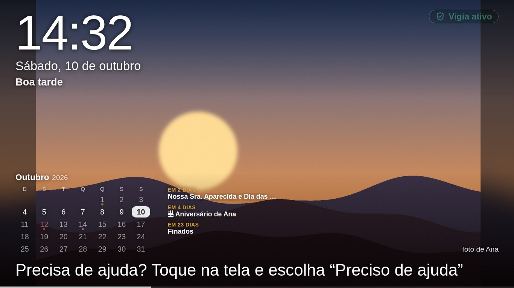
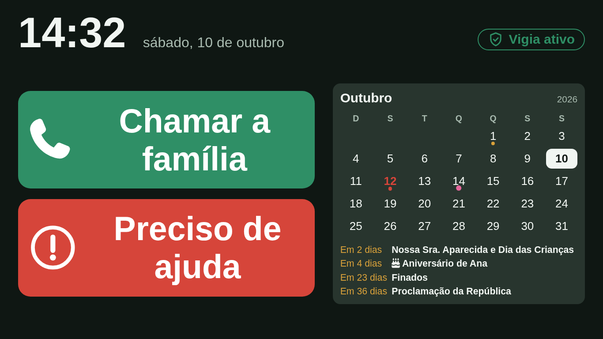
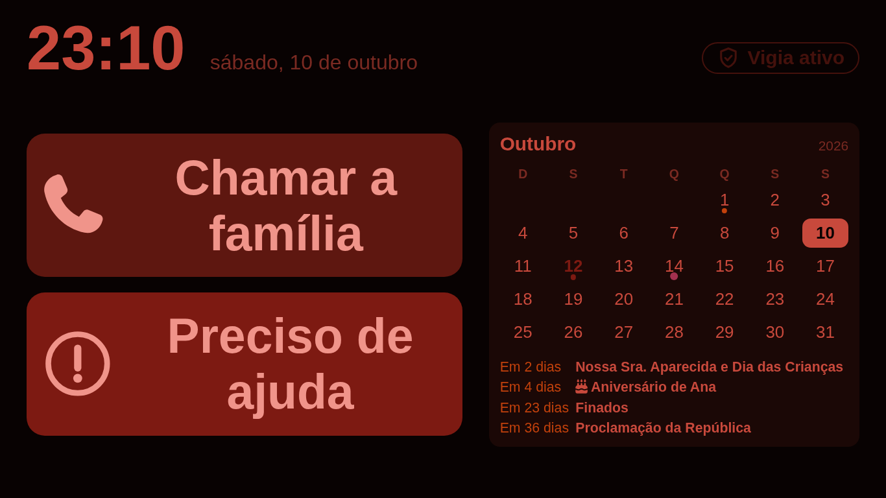
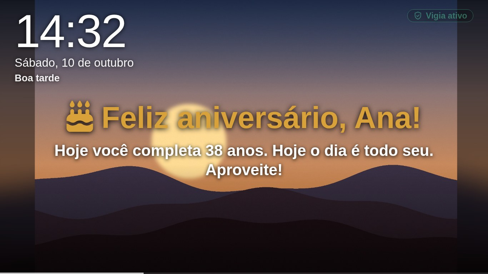
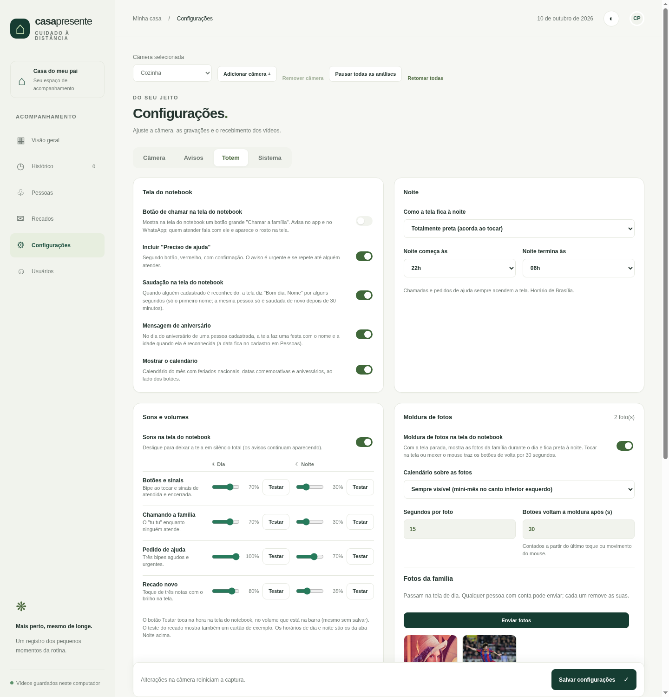

# Totem: a tela do notebook da cozinha

O notebook que serve a câmera também mostra uma tela para quem está em casa: botão de chamar a família,
moldura de fotos, calendário, saudações, lembretes e recados. Ela roda no navegador do próprio notebook e
conversa com o painel por um pequeno serviço local (`notebook/monitor.py`).

| Moldura de fotos | Botões e calendário | Noite, opção "tons de vermelho" |
|---|---|---|
|  |  |  |

| Recado com a saudação | Aniversário |
|---|---|
|  |  |

> As fotos de exemplo destes prints são paisagens geradas por código. As suas ficam só no seu computador.

## Como funciona

```
 painel (app Python) ──consulta a cada 0,5 s com gente na imagem / 3 s sem──▶  monitor.py (notebook, :8765)
        ▲                                                                         │  long-poll /state
        └── confirmações ("Li"), chamadas, testes ◀──────────────────────────────┘
                                                                                  ▼
                                                              Chrome em tela cheia (notebook/kiosk)
```

- O painel envia ao monitor, a cada consulta: modo vigia, se é noite, quem foi reconhecido (com recados
  pendentes), lembretes, aniversários e as configurações da tela. O monitor guarda só isso e as fotos.
- A tela não pergunta o estado a cada segundo: o monitor responde **na hora** em que algo muda
  (long-poll em `/state?v=`) e, no máximo, a cada 3 s.
- O botão de chamar e os recados confirmados voltam ao painel pela mesma consulta, autenticada por um
  token compartilhado.

## Instalação no notebook

1. Copie `notebook/monitor.py` e a pasta `notebook/kiosk/` para `~/.config/casa-monitor/` e instale
   `notebook/casa-monitor.service` como serviço de usuário (`systemctl --user enable --now casa-monitor`).
2. Crie `~/.config/casa-monitor/token` (32 caracteres ou mais) e copie o mesmo valor para
   `data/notebook.token` no servidor do painel.
3. Abra a tela em tela cheia com `notebook/start-kiosk.sh` (por exemplo no `exec-once` do Hyprland ou no
   autostart do seu ambiente gráfico). Ela fica em `http://127.0.0.1:8765/`, acessível só ao próprio notebook.
4. No painel, ative **Configurações → Avisos → Notebook da câmera** e **Botão de chamar na tela**.

Depois de atualizar os arquivos do totem, a tela se recarrega sozinha (ela compara a versão a cada resposta).

## O que a tela faz

**Quando está parada, de dia:** moldura de fotos com relógio grande, data, linha "Hoje/Amanhã"
(feriados e aniversários), mini-calendário do mês, mensagens que alternam (dicas, datas especiais,
contagem para aniversários e as suas mensagens fixas), "foto de Fulano" e uma barra fina de progresso.
A cor do texto muda para escura quando a foto está clara naquela região.

**Quando alguém toca ou mexe o mouse:** os botões voltam por alguns segundos
(*Chamar a família* e *Preciso de ajuda*, com confirmação), ao lado do calendário.

**À noite:** a tela fica preta (ou em tons de vermelho escuro, para não atrapalhar a visão noturna) e o brilho pode
cair ao mínimo. Tocar na tela ou mexer o mouse mostra os botões e o calendário por alguns segundos; chamadas e
pedidos de ajuda sempre acendem a tela. Se você prefere ver as informações à noite, use "tons de vermelho".

**Quando uma pessoa cadastrada é reconhecida:** "Bom dia, Nome" (só o primeiro nome; a mesma pessoa só é
saudada de novo após 30 min). No dia do aniversário, uma festa com a idade e confete. Se houver recado, o
cartão do recado entra junto com a saudação, com um toque de três notas e um brilho âmbar nas bordas.

**Lembretes:** qualquer conta deixa um lembrete com validade de 1 hora a 7 dias; a tela alterna entre eles.

## Recados para pessoas

Na página **Recados** do painel, qualquer conta escreve uma mensagem (até 240 letras) para uma pessoa
cadastrada. Quando ela é reconhecida, o recado aparece como citação, com o primeiro nome de quem escreveu embaixo.

| Modo | Comportamento |
|---|---|
| Até a pessoa tocar em "Li" | Volta a cada reconhecimento (a cada 3 min enquanto ela estiver por perto) até ser lido. O painel mostra "lido em…". |
| Toda vez que a pessoa aparecer | Continua aparecendo até vencer, respeitando o intervalo longo de 30 min. |
| Visualização única | Aparece com o toque de aviso, mostra uma contagem e some em 30 s. É consumido quando a tela o exibe e não volta. |

- **Privacidade:** cada conta só lista os recados que ela mesma escreveu (administradores também) e só o autor
  pode removê-los. O texto não aparece no log do servidor.
- Com a tela preta à noite, nada é consumido: o recado espera a próxima oportunidade.
- Se o reconhecimento facial confundir duas pessoas, o recado pode aparecer para a pessoa errada: evite segredos.

## Fotos

Qualquer conta envia fotos em **Configurações → Totem → Moldura de fotos**. O painel as reduz (1920 px),
cria miniaturas e as sincroniza com o notebook. Cada pessoa remove as suas; administradores removem qualquer
uma. O nome de quem enviou acompanha a conta se ela for renomeada em **Minha conta → Meu perfil**.

## Tela desligada à noite

Em **Configurações → Totem → Noite → Como a tela fica à noite**, a opção **"Desligar a tela (liga quando alguém
aparece)"** apaga o painel de verdade (DPMS), poupando energia e eliminando qualquer luz no quarto. Quando alguém
aparece na câmera, a tela liga em cerca de um segundo e mostra a moldura (ou os botões e o calendário) com as **cores normais** (só a opção "tons de vermelho" muda as cores);
ela volta a apagar depois do tempo escolhido (padrão 45 s) sem ninguém, e uma chamada sempre a mantém ligada.
Mexer o mouse ou apertar uma tecla também a liga.

- Funciona com **Hyprland** (inclusive o novo formato Lua) e **X11** (`xset`). O monitor habilita sozinho o
  "mouse/teclado ligam a tela" do Hyprland. Em outros ambientes gráficos, a opção não tem efeito.
- Segurança: se o painel ficar mais de 90 s sem falar com o monitor, ou ao reiniciá-lo, a tela é ligada de novo,
  para o notebook nunca ficar apagado por engano.
- O botão **Testar desligar (5 s)** apaga a tela por 5 segundos e liga de novo.
- Depende de a câmera ver a pessoa: a tela liga assim que o reconhecimento de presença a detecta (modo vigia incluído).

## Brilho da tela (noite)

Em **Configurações → Totem → Brilho da tela** (desligado por padrão): de dia a tela usa o brilho que você escolher;
à noite fica no mínimo e **sobe quando alguém aparece na câmera ou toca na tela**, voltando a escurecer depois de
alguns segundos. A subida por toque é imediata; por presença, depende da consulta do painel (até 0,5 s com gente
na imagem). Os botões **Testar** aplicam o brilho por 6 segundos e voltam ao anterior, mesmo sem salvar.

- Funciona em notebooks com brilho controlável (`/sys/class/backlight`). O monitor usa o `logind` (o mesmo caminho do
  `brightnessctl`), então **não precisa de root nem de regra do udev**. Em computadores sem esse controle, não faz nada.
- Se o painel ficar mais de 90 s sem falar com o monitor, a tela volta ao brilho que estava antes.
- Combine com **Noite → tons de vermelho**: a tela continua legível, só que discreta.

## Servidor separado do totem

O monitor do notebook é um microsserviço independente: o painel só precisa alcançá-lo por HTTP com o token.
Se o servidor do painel e o notebook são computadores diferentes, defina no `.env` do servidor:

```bash
NOTEBOOK_URL=http://192.168.1.103:8765     # endereço do notebook (o padrão é o host do RTSP)
```

e mantenha o mesmo token nos dois lados (`data/notebook.token` no servidor e `~/.config/casa-monitor/token`
no notebook). Tudo que o totem faz (fotos, recados, sons, chamadas, brilho, testes) passa por esse serviço; as decisões
ficam no servidor e os efeitos (tela, som, brilho) acontecem onde está o hardware.

## Configurações (aba Totem)

| Painel | Opções |
|---|---|
| Tela do notebook | botão de chamar, "Preciso de ajuda", saudação, mensagem de aniversário, calendário ao lado dos botões |
| Noite | horário próprio, e se a tela fica preta, em tons de vermelho ou igual ao dia |
| Sons e volumes | chave geral e volume (0 a 100) de **dia e de noite** para botões e sinais, chamando, pedido de ajuda e recado novo; botão **Testar** que toca na hora no notebook, mesmo antes de salvar |
| Brilho da tela | liga/desliga, brilho de dia, de noite sem ninguém e de noite com alguém por perto, tempo que fica claro, botões Testar |
| Moldura de fotos | liga/desliga, segundos por foto, tempo até os botões voltarem à moldura, calendário sobre as fotos (sempre, a cada minuto ou nunca), envio e lista de fotos |
| Lembretes e mensagens | deixar lembretes e as mensagens fixas da moldura |



## Resolução de problemas

- **A tela mostra "Chamada indisponível":** o painel não consultou o monitor nos últimos 30 s. Confira o
  serviço `casa-monitor` no notebook, o token (`data/notebook.token` igual ao do notebook) e a rede.
- **Os sons não tocam:** o Chrome precisa de `--autoplay-policy=no-user-gesture-required` (já em
  `start-kiosk.sh`). Use **Testar** em Sons e volumes e confira o volume do sistema.
- **O recado não aparece:** com a tela preta (noite) ele espera; sem reconhecimento facial da pessoa
  também. Recados "até confirmar" voltam a cada 3 min.
- **Reiniciar só a tela:** feche o Chrome do totem e rode `notebook/start-kiosk.sh` de novo.
